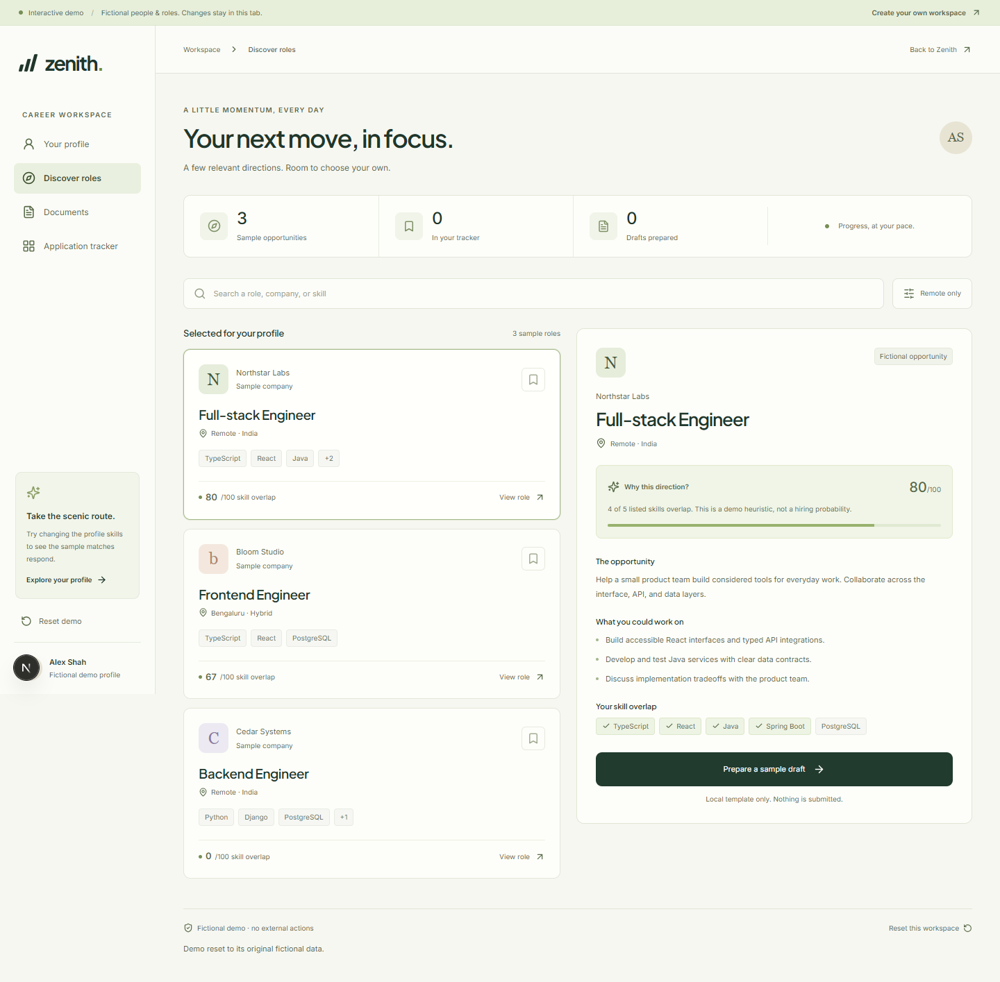
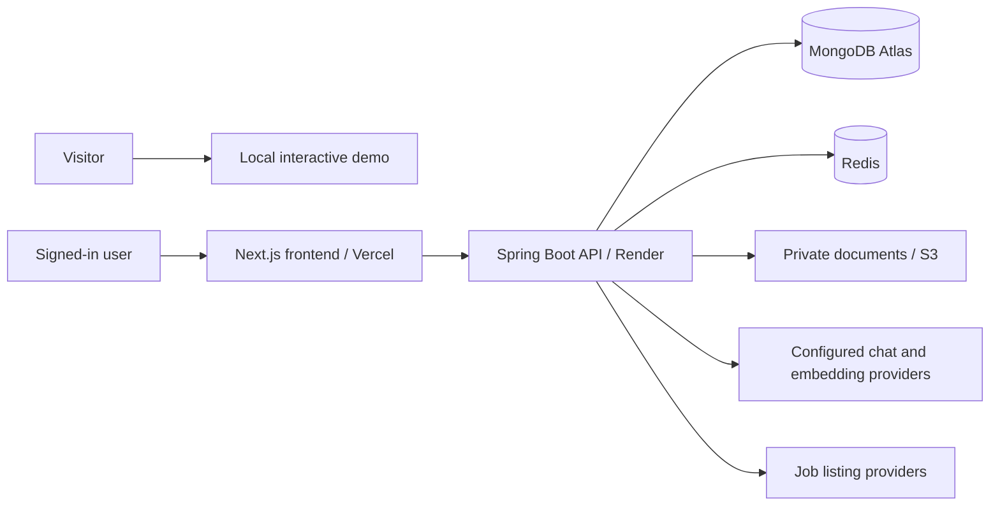

# Zenith

A career workspace that connects your resume, relevant roles, application drafts, and next steps.

[Live website](https://zenith-ai-careers.vercel.app/) · [Try the interactive demo](https://zenith-ai-careers.vercel.app/demo) · [Setup guide](docs/SETUP.md)



## Try it in two minutes

Open the demo without creating an account. Change the fictional profile's skills, compare matching roles, prepare and edit a sample cover note, then move an opportunity through the tracker. The demo runs locally in the browser: it uses fictional companies and template text, makes no AI requests, and resets when the page reloads.

The authenticated product connects to the Spring Boot backend for resume parsing, job discovery, AI-assisted document preparation, and saved application records.

## What it demonstrates

| Area | Implementation |
| --- | --- |
| Product and UI | Responsive Next.js workspace, searchable role discovery, clear empty states, keyboard navigation, editable demo documents |
| Backend engineering | Java 21, Spring Boot 3.5, REST APIs, Spring Security, asynchronous preparation and job synchronization |
| Search | MongoDB Atlas vector retrieval with configurable embedding providers and a separate weighted relevance heuristic |
| Document generation | Resume evidence selection, Thymeleaf PDF templates, S3 storage, cover notes and interview preparation |
| Data integrity | Preparing documents preserves the application stage; only an explicit user action records Applied |
| Access control | Owner-scoped assistant sessions and application records, restricted registration roles, private document URLs |
| Delivery | Maven and frontend checks in GitHub Actions, Git-connected Vercel and Render deployments |

## Important product decisions

**Scores explain relevance.** Production matching combines available skill, title, experience, location and semantic evidence into a 0–100 heuristic. Missing evidence contributes zero; there is no artificial minimum score. Scores are not hiring probabilities or measured model accuracy. The public demo uses a simpler, visible skill-overlap calculation.

**Resume facts stay grounded.** For tailored resumes, the model chooses indices from explicit profile evidence. The backend reconstructs the original records rather than accepting invented skills, projects or employment history. Uploaded resume parsing and generated prose still need the user's review.

**A prepared document is not a submitted application.** Document updates preserve the tracked stage, including concurrent user changes. An application date is recorded when the user explicitly chooses Applied. Zenith does not automatically submit applications.

**Visitors can inspect the product immediately.** The public demo is isolated from authentication, sockets, push subscriptions and analytics, including when a visitor already has a signed-in session. Community features remain available at /community.

## Architecture



The AI provider adapter supports NVIDIA NIM-compatible endpoints and a Gemini fallback. The Atlas vector index must match the configured embedding model's dimensions; changing models requires rebuilding compatible embeddings.

## Run locally

For the public demo, only Node.js and npm are required:

```sh
cd ai-career-forge-frontend
npm ci
npm run dev
```

Open http://localhost:3000/demo. For the full product, follow [the backend and environment setup guide](docs/SETUP.md).

## Verify changes

```sh
# In ai-career-forge-backend (Java 21, Maven 3.9+)
mvn --batch-mode verify

# In ai-career-forge-frontend
npm ci
npm run lint
npm test
npm run build
```

Backend tests cover access control, registration roles, resume evidence selection, application transitions and scoring. Frontend core tests cover matching and application-state decisions. Browser checks cover responsive layouts, keyboard interaction and the demo workflow; automated accessibility checks supplement visual review rather than prove complete accessibility.

## Project context

Built by [Bhuvnesh Pal](https://github.com/bhuvicoder01) as a major project for the B.Tech in Computer Science Engineering at ITM University, Gwalior (2022–2026), and continued as a software engineering portfolio project.

The backend currently uses a free Render instance, so the first authenticated API request after inactivity may take longer. The static landing page and local demo do not depend on that server waking up.

## Next engineering milestones

- A documented evaluation dataset for matching relevance and resume parsing.
- Durable, retryable preparation jobs with cancellation and progress recovery.
- Integration tests against isolated MongoDB, Redis and object storage.
- Measured performance budgets and broader authenticated accessibility coverage.
